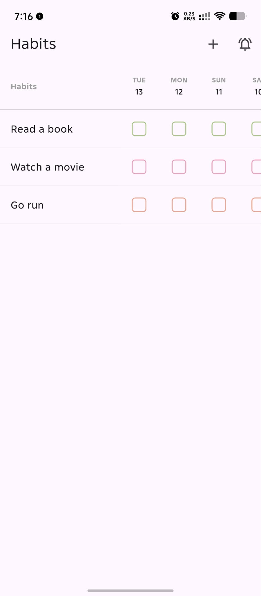
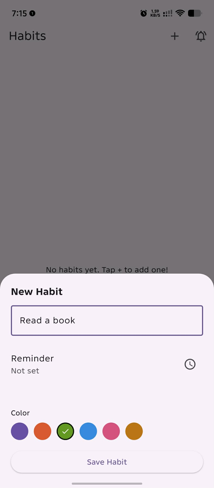
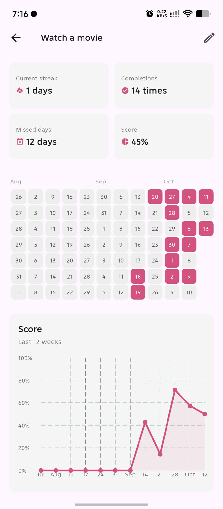

# Habit Tracker

I built this Flutter app to keep track of habits and to learn app development by building something I can use. I can mark completions by date and check how consistently I've kept up with each habit.

## Screenshots







## Features

- **Track habits by date:** The dashboard shows habit rows against a horizontally scrollable grid of today and the previous 364 days. Tap a cell to mark that habit complete for the date, or tap it again to undo it.
- **Manage habits:** Create a habit with a title and color. Long-press a habit to edit it, archive it, or delete it. Deleting asks for confirmation and also removes its completion history.
- **Review progress:** Open a habit to see its current streak, total completions, missed days, and consistency score. Its detail screen also has a calendar view of recent completions and a score chart for the last 12 weeks.
- **Send a test notification:** On Android, use the notification button on the dashboard to request notification permission and send a test message.

## Tech stack

- **Dart `^3.13.2` and Flutter** — app language and UI framework. The Flutter SDK version isn't pinned in `pubspec.yaml`.
- **flutter_riverpod `^3.4.3`** — UI state and dependency providers.
- **drift `^2.34.4` and sqlite3_flutter_libs `^0.6.0+eol`** — typed SQLite database and native SQLite support.
- **path_provider `^2.1.6` and path `^1.9.1`** — locate the app documents folder and build the database file path.
- **rxdart `^0.28.0`** — combine log streams for the dashboard.
- **intl `^0.20.3` and fl_chart `^1.1.1`** — date labels and the progress chart.
- **flutter_local_notifications `^22.3.1`** — show the Android test notification.
- **flutter_test** — Flutter's test framework. `pubspec.yaml` also declares `flutter_lints ^6.0.0`, `drift_dev ^2.34.6`, and `build_runner ^2.16.1` for linting and generated Drift code.

## How it's built

`main.dart` initializes `NotificationService` and starts the app inside a Riverpod `ProviderScope`. The dashboard and detail screens are Consumer widgets. `HabitDashboardNotifier` holds dashboard state and calls the `HabitRepository` interface; `HabitRepositoryImpl` connects that interface to Drift and maps database rows to domain models.

`AppDatabase` defines three tables: `Habits`, `HabitLogs`, and `HabitReminders`. Logs and reminders reference a habit and are set to cascade-delete with it. `HabitDao`, `HabitLogDao`, and `HabitReminderDao` read and write those tables. The dashboard watches habit and completion streams, while `habitAnalyticsProvider` feeds per-habit logs to `StreakEngine` and `ConsistencyEngine` for the detail screen's stats.

Notifications are initialized at startup. The current service only implements an immediate Android test notification; it doesn't schedule notifications from a habit's saved reminder time.

## Project structure

```text
lib/
  main.dart                         App entry point
  core/database/                    Drift database, tables, and DAOs
  core/notifications/               Local notification service
  features/habits/                  Habit models, repository, state, and screens
  features/analytics/               Streak and consistency calculations
test/                               Database and widget tests
```

## Setup and running

Install Flutter with a Dart SDK matching the `^3.13.2` constraint in `pubspec.yaml`. From the project root, run:

```sh
flutter pub get
flutter run
```

Run the tests with:

```sh
flutter test
```

## Status / what's not done yet

- Habit reminders can be entered and saved, but aren't scheduled; the dashboard notification button only sends a manual test notification.
- The create form always makes daily habits. Weekly, monthly, and custom schedules exist in the model but aren't selectable in the UI.
- The edit form only loads the habit title, not its saved color or reminder, and still displays "New Habit." Saving without choosing a color changes it to the default.
- The widget test is still the Flutter starter counter test; the current app-specific tests cover some database DAO behavior.
